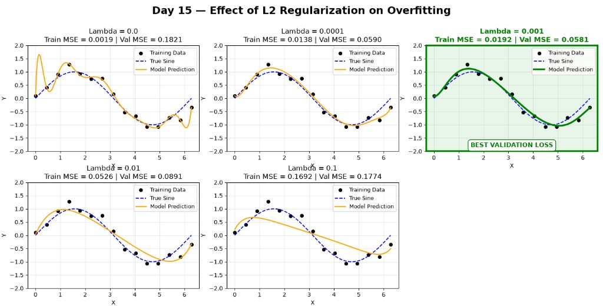

# Day 015 — L2 regularization and overfitting

`src/day_015/main.py` fits polynomials to a noisy sine wave and shows how an L2 penalty changes a degree-12 fit. The noise comes from `np.random.seed(42)`, so every run prints the same losses. The script also opens the chart below and saves it as `l2_regularization_comparison.png` in the folder where you run it.

Training uses 15 evenly spaced inputs from `0` to `2π`. Targets are `sin(x)` plus Gaussian noise with standard deviation `0.2`. Validation uses 100 evenly spaced inputs and an independent draw of the same noise. For the regularized fits, both sets of inputs are scaled with `(x - π) / π`.

## What it does

1. Fits unregularized polynomials of degree 1, 3, and 12 with least squares, and prints train and validation mean squared error.
2. Fits a degree-12 polynomial five times, with `lambda` in `0`, `0.0001`, `0.001`, `0.01`, and `0.1`.
3. For `lambda = 0`, solves the least-squares problem. For the other values, solves `(XᵀX + nλI) w = Xᵀy`. The bias column of `I` is set to `0`, so the intercept is left unpenalized. `n` is the number of training points.
4. Draws each fit against the 15 training points and the true sine. The panel with the lowest validation loss, `lambda = 0.001`, is drawn in green.

Degree 12 with no penalty memorizes the training noise: train MSE is about `0.0019` and validation MSE is about `0.182`. A degree-3 fit is smoother, with validation MSE about `0.064`.

| Degree | Train MSE | Validation MSE |
| --- | --- | --- |
| 1 | 0.2513 | 0.2463 |
| 3 | 0.0243 | 0.0640 |
| 12 | 0.0019 | 0.1821 |

On the scaled degree-12 models, raising `lambda` lifts the training error and, up to a point, lowers the validation error. `lambda = 0.001` has the best validation MSE, about `0.0581`. `lambda = 0.1` flattens the curve and the validation error rises again.

| Lambda | Train MSE | Validation MSE |
| --- | --- | --- |
| 0 | 0.0019 | 0.1821 |
| 0.0001 | 0.0138 | 0.0590 |
| 0.001 | 0.0192 | 0.0581 |
| 0.01 | 0.0526 | 0.0891 |
| 0.1 | 0.1692 | 0.1774 |



## Setup

Python 3.12 or newer, and [uv](https://docs.astral.sh/uv/). Dependencies live in `pyproject.toml` and are locked in `uv.lock`. This day needs NumPy and matplotlib.

From this folder:

```bash
uv sync
```

## Run

```bash
uv run python src/day_015/main.py
```

Close the chart window when you are done viewing it.
