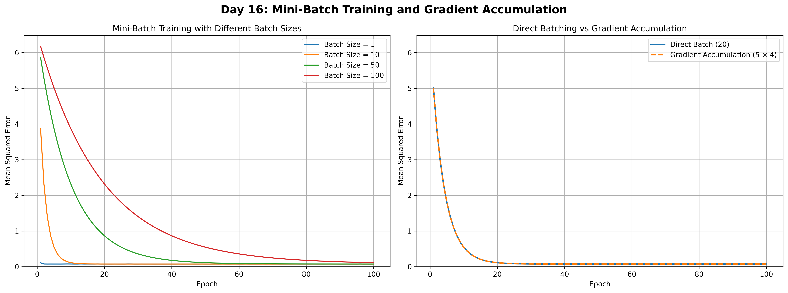

# Day 016 — Mini-batch training and gradient accumulation

`src/day_016/main.py` fits a line to 100 noisy points with mini-batch gradient descent. The inputs run from `-2` to `2`. The targets are `2x + 1` plus Gaussian noise with standard deviation `0.3`, drawn with `np.random.seed(42)`. Training starts at weight `0` and bias `0`, uses learning rate `0.01`, and runs for 100 epochs. The loss is mean squared error. The script prints the fitted weight, bias, and final loss, then opens the chart below and saves it as `day_016_training_comparison.png`.

## What it does

1. Trains with batch sizes `1`, `10`, `50`, and `100`. Each run reshuffles the data with seed `42`. A smaller batch means more weight updates per epoch, so the loss drops sooner. After 100 epochs the batch of `100` still has the highest loss, because it takes only one step per epoch.
2. Compares one batch of `20` with four micro-batches of `5` whose gradients are accumulated before a single update. Both runs use seed `123`. The accumulated gradient is the sample-weighted average of the micro-batch gradients, so it matches the gradient of the batch of `20`. The fitted weight, bias, and loss are identical, and the two curves on the right lie on top of each other.

The true slope is `2` and the true intercept is `1`. The faster schedules finish near those values. The noise floor of this sample is a mean squared error of about `0.073`.

| Batch size | Weight | Bias | Final MSE |
| --- | --- | --- | --- |
| 1 | 2.023105 | 0.947521 | 0.074018 |
| 10 | 2.010835 | 0.968806 | 0.073342 |
| 50 | 2.002326 | 0.951775 | 0.073720 |
| 100 | 1.882881 | 0.840358 | 0.111951 |

Direct batch of 20 and gradient accumulation of `5 × 4`:

| Run | Weight | Bias | Final MSE |
| --- | --- | --- | --- |
| Direct batch (20) | 2.010174 | 0.968840 | 0.073341 |
| Accumulation (5 × 4) | 2.010174 | 0.968840 | 0.073341 |

The weight difference and the bias difference are both `0`.



## Setup

Python 3.12 or newer, and [uv](https://docs.astral.sh/uv/). Dependencies live in `pyproject.toml` and are locked in `uv.lock`. This day needs NumPy and matplotlib.

From this folder:

```bash
uv sync
```

## Run

```bash
uv run python src/day_016/main.py
```

Close the chart window when you are done viewing it.
