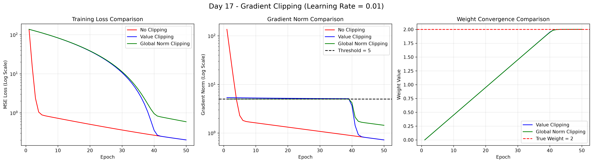
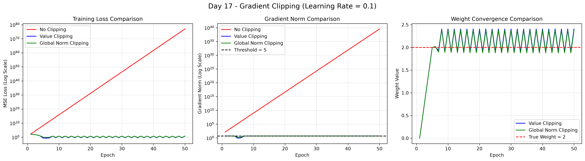

# Day 017 — Gradient clipping

`src/day_017/main.py` fits a line to 100 noisy points with full-batch gradient descent, and compares three ways of handling the gradient. Inputs run from `-10` to `10`. Targets are `2x + 1` plus Gaussian noise with standard deviation `0.3`, drawn with `np.random.seed(42)`. Weight and bias start at `0`. Each run lasts 50 epochs. The loss is mean squared error.

The inputs are large, so the first weight gradient is large. At the start the loss is about `137.3` and the gradient norm is about `136.2`.

## What it does

1. **No clipping.** The raw gradients update the weight and bias.
2. **Value clipping.** Each gradient is clipped to the range `-5` to `5` before the update. The recorded norm uses the clipped gradients.
3. **Global norm clipping.** If the combined norm is above `5`, both gradients are scaled by `5 / norm`. Their direction stays the same and the norm becomes `5`.

The script prints the first 10 epochs of each run, then saves a three-panel chart whose filename includes the learning rate. The panels are training loss, gradient norm, and weight. The weight panel draws only the two clipped runs, plus a dashed line at the true slope `2`.

The file in the repo uses learning rate `0.01`. The same script was also run at `0.1`.

### Learning rate 0.01

Unclipped training takes a large first step and the loss falls within a few epochs. Both clipped runs hold the gradient near the threshold of `5` for about 40 epochs, so the weight climbs steadily toward `2`. After 50 epochs the unclipped run and value clipping have reached a loss of about `0.203`. Global norm clipping is still a little higher, at about `0.592`. All three weights are about `2.002`.



### Learning rate 0.1

The same first gradient, multiplied by `0.1`, throws the unclipped weight to enormous values. By epoch 50 its loss is about `9.1e76`. Value clipping and global norm clipping keep the update inside the threshold, so the weight oscillates around `2` and the loss stays near `5` to `6`.



| Learning rate | Run | Final loss | Final weight |
| --- | --- | --- | --- |
| 0.01 | No clipping | 0.203 | 2.002 |
| 0.01 | Value clipping | 0.203 | 2.002 |
| 0.01 | Global norm clipping | 0.592 | 2.002 |
| 0.1 | No clipping | 9.1e76 | 5.2e37 |
| 0.1 | Value clipping | 5.62 | 2.406 |
| 0.1 | Global norm clipping | 4.88 | 2.378 |

Final loss and weight are the values recorded at the start of epoch 50, before that epoch's update.

## Setup

Python 3.12 or newer, and [uv](https://docs.astral.sh/uv/). Dependencies live in `pyproject.toml` and are locked in `uv.lock`. This day needs NumPy and matplotlib.

From this folder:

```bash
uv sync
```

## Run

```bash
uv run python src/day_017/main.py
```

The chart is written next to the working directory as `day_017_gradient_clipping_lr_0.01.png`. Close the window when you are done viewing it. To reproduce the second chart, set `learning_rate` to `0.1` and run the script again.
