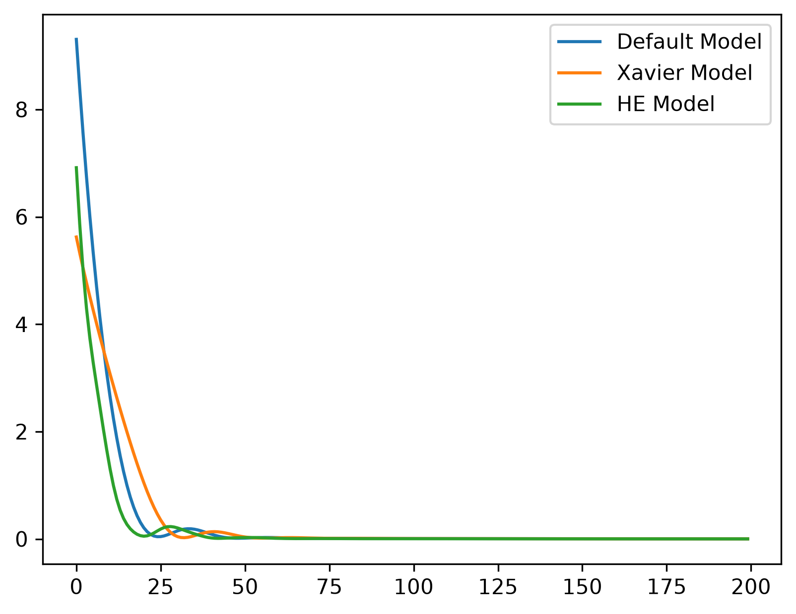

# Day 018 — Weight initialization

`src/day_018/main.py` trains three small networks to fit `y = 2x + 1`. The inputs are 100 evenly spaced values from `-2` to `2`, with no added noise. Each network has a linear layer from 1 to 32 units, a ReLU, and a linear layer back to 1 output. Training uses Adam with learning rate `0.01`, mean squared error, and the full set of points on every step, for 200 epochs. `torch.manual_seed(42)` fixes the starting weights.

## What it does

1. Builds a default model and leaves `nn.Linear` initialization in place.
2. Builds a second model and replaces the first-layer weight with Xavier uniform initialization (`nn.init.xavier_uniform_`).
3. Builds a third model and replaces the first-layer weight with He initialization (`nn.init.kaiming_uniform_` with `nonlinearity="relu"`).
4. Trains each model and prints the first and last loss.
5. Plots the three loss curves.

Xavier and He replace only the first-layer weight. The second layer and both biases stay at the values drawn when that model was created.

All three losses fall to about `0` within the first 75 epochs, with a small bump around epochs 25 to 50. He ends with the lowest loss.

| Initialization | First loss | Last loss |
| --- | --- | --- |
| Default | 9.305 | 0.001344 |
| Xavier | 5.624 | 0.001641 |
| He | 6.915 | 0.001054 |



## Setup

Python 3.12 or newer, and [uv](https://docs.astral.sh/uv/). Dependencies live in `pyproject.toml` and are locked in `uv.lock`. This day needs PyTorch and matplotlib.

From this folder:

```bash
uv sync
```

## Run

```bash
uv run python src/day_018/main.py
```

Close the chart window when you are done viewing it.
